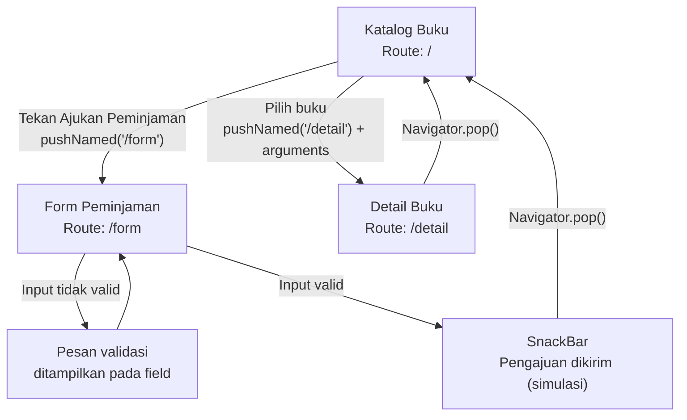

# Navigation Flow — PustakaKu

## 1. Deskripsi

PustakaKu merupakan prototype aplikasi perpustakaan kampus yang membantu pengguna melihat katalog buku, memeriksa ketersediaan buku, dan mengakses alur pengajuan peminjaman.

Pada Tugas 6, halaman katalog dikembangkan dengan navigasi bernama, pengiriman data antarlayar, validasi form, dan feedback interaksi menggunakan komponen bawaan Flutter.

## 2. Daftar Route

| Nama Route | Nama Layar | Kebutuhan yang Dipenuhi | Keterangan |
|---|---|---|---|
| `/` | Katalog Buku | ID kebutuhan katalog dari Tugas 4–5 *(perlu diverifikasi)* | Halaman awal aplikasi |
| `/form` | Form Peminjaman | ID kebutuhan pengajuan peminjaman dari Tugas 4–5 *(perlu diverifikasi)* | Tempat pengguna mengisi data peminjaman |
| `/detail` | Detail Buku | ID kebutuhan informasi buku dari Tugas 4–5 *(perlu diverifikasi)* | Menampilkan informasi buku yang dipilih |

## 3. Navigation Flow

## 4. Penjelasan Alur

### 4.1 Katalog Buku

Katalog Buku menjadi halaman awal yang menampilkan daftar buku beserta judul, penulis, dan status ketersediaan. Dari halaman ini, pengguna dapat membuka form peminjaman atau memilih buku untuk melihat detailnya.

### 4.2 Form Peminjaman

Form Peminjaman dibuka melalui `Navigator.pushNamed(context, '/form')`. Pengguna mengisi data yang diperlukan, kemudian menekan tombol kirim.

Setiap field wajib memiliki validator yang sesuai. Jika terdapat input kosong atau tidak valid, pesan kesalahan ditampilkan dan proses pengiriman dihentikan. Jika seluruh input valid, aplikasi menampilkan `SnackBar` sebagai feedback simulasi, lalu kembali ke katalog menggunakan `Navigator.pop(context)`.

### 4.3 Detail Buku

Detail Buku dibuka melalui `Navigator.pushNamed(context, '/detail', arguments: dataBuku)`. Data buku yang dipilih dikirim melalui `arguments`, kemudian diperiksa tipenya pada halaman tujuan.

Jika data tidak tersedia atau tipenya tidak sesuai, halaman menampilkan pesan pengganti agar aplikasi tidak mengalami error. Pengguna dapat kembali ke katalog melalui `Navigator.pop(context)`.

## 5. Alasan Pemilihan `initialRoute`

Route `/` dipilih sebagai `initialRoute` karena katalog merupakan halaman utama PustakaKu dan menjadi titik awal pengguna untuk menemukan buku sebelum melanjutkan ke proses peminjaman atau melihat detail buku.

## 6. Konsistensi dengan Implementasi

Nama route pada dokumen ini harus sama persis dengan nama route yang didaftarkan pada `MaterialApp` dan yang digunakan dalam setiap pemanggilan `Navigator.pushNamed`.

| Komponen | Ketentuan |
|---|---|
| `initialRoute` | `/` |
| Route katalog | `/` |
| Route form | `/form` |
| Route detail | `/detail` |
| Pengiriman data | `arguments` dari katalog ke detail |
| Navigasi kembali | `Navigator.pop(context)` |
| Feedback pengiriman | `SnackBar` setelah validasi berhasil |
| Penyimpanan data | Belum dilakukan; pengiriman masih berupa simulasi |

## 7. Catatan Verifikasi

Sebelum dokumen dikumpulkan, cocokkan setiap kebutuhan pada tabel route dengan ID kebutuhan fungsional dari Tugas 4–5. Pastikan setiap route sesuai dengan information architecture dan setiap alur yang digambarkan benar-benar diterapkan pada kode `form-interaksi.dart`.

