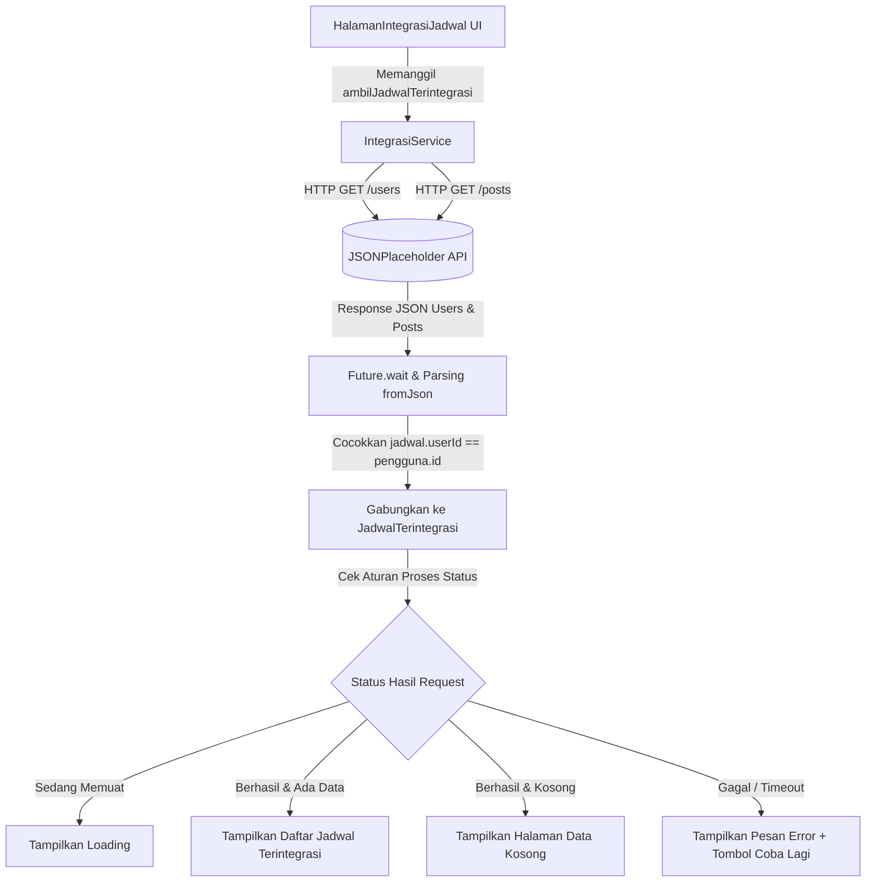

# Tugas 10: Integrasi Data dan Proses Bisnis

**Nama**  : Deyna Angeliawati Zahara  
**NPM**   : 230660221032  
**Kelas** : SI VII B  

## 1. Deskripsi Aplikasi
Aplikasi **RadiAct (UNSAP Radio)** pada tugas ini dikembangkan untuk menggabungkan data jadwal siaran dengan data Penanggung Jawab (PJ) divisi dari dua alamat API berbeda, serta menerapkan aturan perubahan status jadwal.

## 2. Endpoint dan Metode HTTP yang Digunakan

| Kebutuhan Data | Metode HTTP | URL Endpoint | Keterangan |
|:---------------|:------------|:-------------|:-----------|
| Ambil daftar penanggung jawab (PJ) | `GET` | `https://jsonplaceholder.typicode.com/users` | Mengambil `id`, `name`, dan `email` penanggung jawab divisi. |
| Ambil daftar jadwal siaran | `GET` | `https://jsonplaceholder.typicode.com/posts` | Mengambil daftar jadwal program beserta nomor penghubung `userId`. |

## 3. Tabel Pemetaan Field JSON ke Model Dart

### A. Model `DataPengguna`
| Nama Field di Dart | Tipe Data | Key JSON (`/users`) | Keterangan / Nilai Default |
|:-------------------|:----------|:--------------------|:---------------------------|
| `id` | `int` | `"id"` | Nomor identitas pengguna (default: `0`). |
| `nama` | `String` | `"name"` | Nama penanggung jawab (default: `'PJ Belum Ditentukan'`). |
| `email` | `String` | `"email"` | Alamat email penanggung jawab (default: `'-'`). |

### B. Model `DataJadwal`
| Nama Field di Dart | Tipe Data | Key JSON (`/posts`) | Keterangan / Nilai Default |
|:-------------------|:----------|:--------------------|:---------------------------|
| `id` | `int` | `"id"` | Nomor identitas jadwal (default: `0`). |
| `userId` | `int` | `"userId"` | Nomor penghubung ke `id` milik `DataPengguna` (default: `0`). |
| `judul` | `String` | `"title"` | Judul program siaran (default: `'Program Tanpa Judul'`). |
| `divisi` | `String` | `"divisi"` / `"userId"` | Disesuaikan ke nama divisi UNSAP Radio (Edukasi, Entertain, Marcomm, Redaksi). |
| `tanggal` | `String` | `"tanggal"` | Tanggal jadwal tayang (default: `'25 November 2026'`). |
| `status` | `StatusJadwal` | `"id"` | Status jadwal (`Progres`, `Tayang`, `Terkendala`). |
| `catatan` | `String` | `"body"` | Catatan program (default: `'Tidak ada catatan.'`). |

## 4. Identifier Penghubung & Alasan Penggunaan `Future.wait`
* **Identifier Penghubung:** Data dari `/posts` dan `/users` digabungkan lewat **`userId`** yang ada di `DataJadwal` dengan mencocokkannya ke **`id`** yang ada di `DataPengguna`, lalu disimpan ke model gabungan `JadwalTerintegrasi`.
* **Alasan Penggunaan `Future.wait`:** Pengambilan data dari `/users` dan `/posts` tidak saling menunggu satu sama lain. Memakai `Future.wait` membuat kedua permintaan dijalankan bersamaan sehingga proses memuat data lebih cepat daripada dipanggil satu per satu.

## 5. Diagram Alur Request dan Response


## 6. Batasan API Simulasi
Seluruh data yang tampil pada aplikasi ini diambil dari layanan uji coba publik JSONPlaceholder sehingga masih bersifat dummy untuk kebutuhan praktikum integrasi multi-endpoint. Data pada `/posts` dan `/users` hanya dipakai sebagai percontohan jadwal produksi serta penanggung jawab divisi, sehingga teks judul maupun perubahan status program di dalamnya tidak tersimpan permanen dan bukan merupakan jadwal siaran aktif di UNSAP Radio.

## 7. Cara Menjalankan Aplikasi
1. Buka terminal pada folder proyek, lalu jalankan perintah untuk mengunduh dependensi: `flutter pub get`
2. Jalankan aplikasi pada target Google Chrome: `flutter run -d chrome`

## 8. Struktur Folder
```
tugas-10
├── lib/
│   ├── main.dart
│   ├── models/
│   └── services/
├── pubspec.yaml
├── README.md
└── refleksi.md