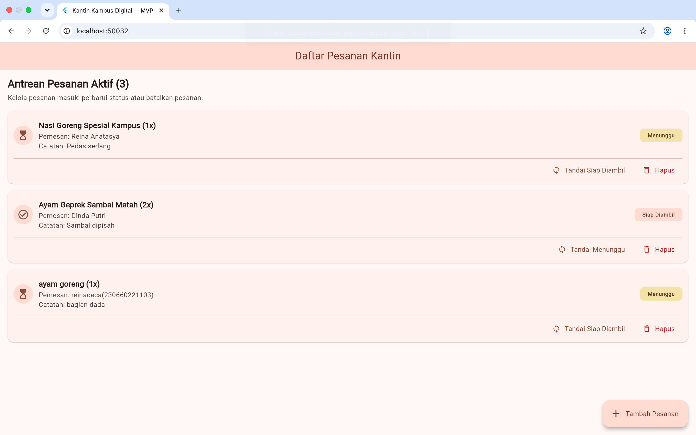
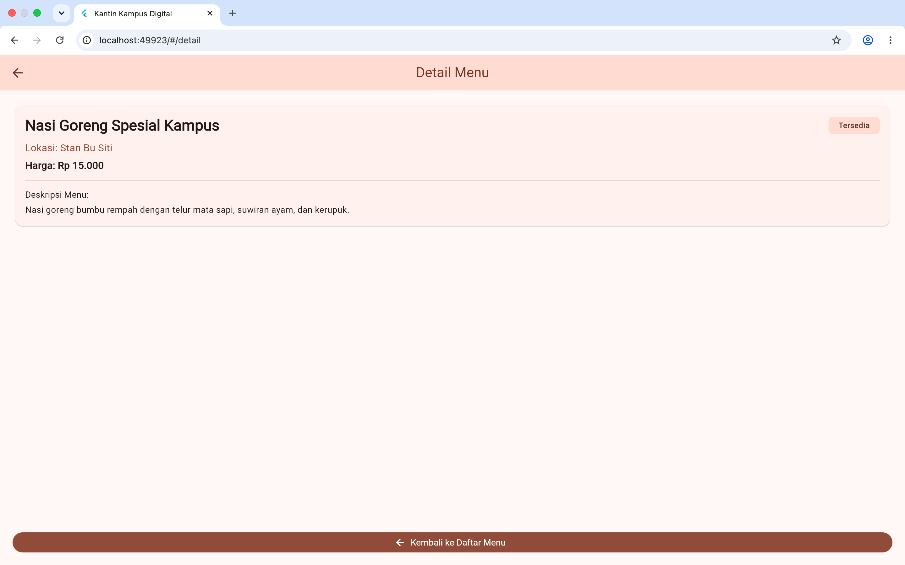
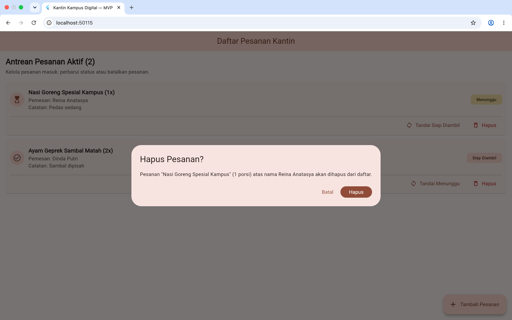

# Laporan Progress Project UTS (Milestone M4)

| | |
| :--- | :--- |
| **Nama** | Reina Anatasya Kusumah Putri |
| **NIM** | 230660221103 |
| **Kelas** | SI-VIIB |
| **Domain SI** | Pemesanan & Antrean Kantin Kampus |
| **Judul Aplikasi** | Kantin Kampus Digital |
| **Tautan Repository** | https://github.com/PBWFEND/SI-VIIB-Mobile/tree/230660221103/tugas-8 |

---

## 1. Ringkasan Eksekutif Project

Aplikasi **Kantin Kampus Digital** dirancang untuk mengatasi permasalahan antrean fisik yang padat pada jam istirahat kuliah serta ketidakpastian informasi ketersediaan stok makanan di stan kantin kampus. Melalui aplikasi mobile ini, mahasiswa (persona Dinda) dapat memeriksa katalog menu beserta status ketersediaannya secara cepat, mengirimkan pesanan lebih awal di sela jadwal kuliah, serta memantau progres kesiapan pesanan tanpa harus mengantre lama di depan stan, sementara pengelola stan dapat memperbarui status pesanan masuk secara terstruktur.

Solusi berbasis aplikasi mobile dipilih karena mahasiswa membutuhkan akses instan saat sedang berpindah kelas (*mobile context*), interaksi layar sentuh yang ringkas untuk sesi penggunaan singkat (2–5 menit), serta kemudahan pembaruan status pesanan secara langsung di perangkat genggaman.

---

## 2. Ketercapaian Milestone (M1 s.d. M3)

| Milestone | Deliverable | Status (Selesai / Sebagian) | Catatan / Bukti |
| :--- | :--- | :--- | :--- |
| **M1: Kebutuhan** | Dokumen kebutuhan + User Flow | **Selesai** | File `dokumen-kebutuhan.md` dan `user-flow.png` pada folder `tugas-4/` |
| **M2: UI/UX** | Wireframe + Navigasi | **Selesai** | File `information-architecture.md`, `wireframe.png`, `halaman-utama.dart` (`tugas-5/`), serta `navigation-flow.md` & `form-interaksi.dart` (`tugas-6/`) |
| **M3: MVP Awal** | Model data + CRUD lokal | **Selesai** | File `model-data.md` dan `crud-lokal.dart` dengan operasi Create, Read, Update, Delete berbasis `id` pada folder `tugas-7/` |

---

## 3. Matriks Kebutuhan ke Implementasi

| ID Kebutuhan | Deskripsi Kebutuhan | Prioritas MoSCoW | Halaman Pemenuh | Operasi Data Terkait |
| :--- | :--- | :---: | :--- | :--- |
| **F-01** | Mahasiswa melihat daftar menu makanan dan status ketersediaan stok | **Must** | Halaman Utama Katalog (`tugas-5` & `tugas-6`) | **Read** |
| **F-03** | Mahasiswa memilih menu dan menentukan jumlah porsi pesanan | **Must** | Halaman Detail Menu & Form Pemesanan (`tugas-6` & `tugas-7`) | **Create** |
| **F-04** | Mahasiswa mengirimkan konfirmasi pesanan ke daftar antrean | **Must** | Halaman Form Tambah Pesanan (`crud-lokal.dart`) | **Create** |
| **F-05** | Mahasiswa memantau daftar dan status pesanan aktif | **Must** | Halaman Daftar Pesanan Kantin (`crud-lokal.dart`) | **Read** |
| **F-06** | Pengelola stan mengubah status pesanan (`Menunggu` ↔ `Siap Diambil`) | **Must** | Halaman Daftar Pesanan Kantin (`crud-lokal.dart`) | **Update** |
| **F-07** | Pembatalan / penghapusan pesanan yang keliru dengan konfirmasi | **Should** | Halaman Daftar Pesanan Kantin (`AlertDialog` pada `crud-lokal.dart`) | **Delete** |

---

## 4. Tangkapan Layar Aplikasi Berjalan

1. **Halaman Utama / Daftar Data Hasil Tambah (`screenshot-daftar.png`)**
   * Menampilkan daftar antrean pesanan kantin menggunakan `ListView.builder` setelah data pesanan baru berhasil ditambahkan melalui formulir.
   * 

2. **Halaman Form Pengisian Data & Detail Alur (`screenshot-alur.png`)**
   * Menampilkan alur navigasi antarlayar yang membawa objek data serta validasi form sebelum data disimpan ke dalam state.
   * 

3. **Dialog Konfirmasi Aksi Hapus (`screenshot-hapus.png`)**
   * Menampilkan `AlertDialog` konfirmasi penghapusan pesanan berdasarkan kunci unik `id` sebelum data dihapus dari daftar.
   * 

---

## 5. Kendala dan Solusi Teknis

| No. | Kendala | Cara Mengatasinya |
| :---: | :--- | :--- |
| 1 | **Error tata letak `ListView.builder` di dalam `Column`:** Saat menyusun layar daftar, `ListView.builder` sempat gagal dirender karena `Column` memberikan tinggi tak terbatas (*unbounded height*). | Membungkus `ListView.builder` dengan widget **`Expanded`** agar daftar mengambil sisa tinggi layar yang tersedia secara terukur. |
| 2 | **Pembaruan tampilan & keamanan kunci saat hapus/ubah data:** Perubahan status pesanan awalnya berisiko salah sasaran bila mengandalkan indeks posisi list yang bergeser saat item dihapus. | Menggunakan pengenal unik **`id`** berbasis timestamp pada model `DataPesanan`, mencari posisi dengan `indexWhere((item) => item.id == id)`, mengganti objek secara *immutable*, dan membungkus perubahan di dalam **`setState()`**. |

---

## 6. Rencana Pengembangan Milestone M5 (REST API)

Pada tahap pengembangan **Milestone M5 (Pertemuan 9–10)**, aplikasi **Kantin Kampus Digital** akan diintegrasikan dengan layanan backend melalui **REST API** menggunakan package `http` untuk menggantikan data statis dan penyimpanan lokal sementara (*in-memory*):

1. **Endpoint Katalog Menu (`GET /api/menus`):** Mengambil daftar menu, harga, nama stan, dan status stok *real-time* dari basis data server kantin menggunakan `FutureBuilder` atau pemuatan asinkron (`async`/`await`) disertai indikator *loading* dan penanganan error jaringan.
2. **Endpoint Transaksi Pesanan (`POST /api/orders`, `GET /api/orders`, `PATCH /api/orders/{id}`):** Mengirimkan data pesanan baru dari formulir mahasiswa ke server backend sehingga pengelola stan dan mahasiswa dapat menyinkronkan status pesanan (`menunggu`, `diproses`, `siap diambil`) secara nyata lintas perangkat.

---

## 7. Refleksi Pembelajaran Tengah Semester

Selama setengah semester pertama ini, saya memahami bahwa membangun aplikasi mobile berbasis Flutter tidak sekadar menyusun tampilan widget secara visual, melainkan menjaga keterlacakan antara analisis kebutuhan pengguna, alur navigasi, struktur model data, dan pengelolaan state. Penggunaan `StatefulWidget` bersama `setState()` serta pemodelan data *immutable* dengan kunci unik `id` memberikan fondasi yang kuat agar tampilan antarmuka selalu sinkron dengan perubahan data pengguna. Tantangan utama ke depan adalah menghubungkan state lokal MVP ini dengan komunikasi jaringan asinkron melalui REST API pada paruh kedua semester.

---

Deklarasi penggunaan AI: Gemini — membantu memeriksa struktur keterlacakan matriks kebutuhan ke implementasi serta merapikan tata letak laporan progress; seluruh kode MVP, pengujian aplikasi, dan jawaban tes konsep disusun serta diverifikasi oleh penulis.