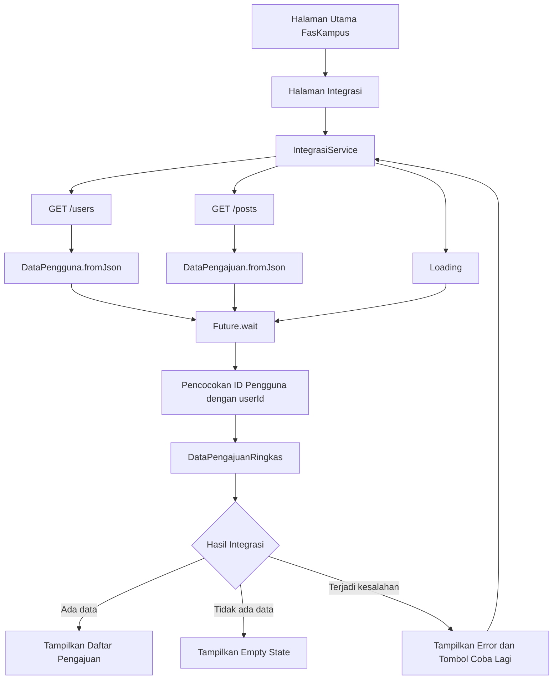
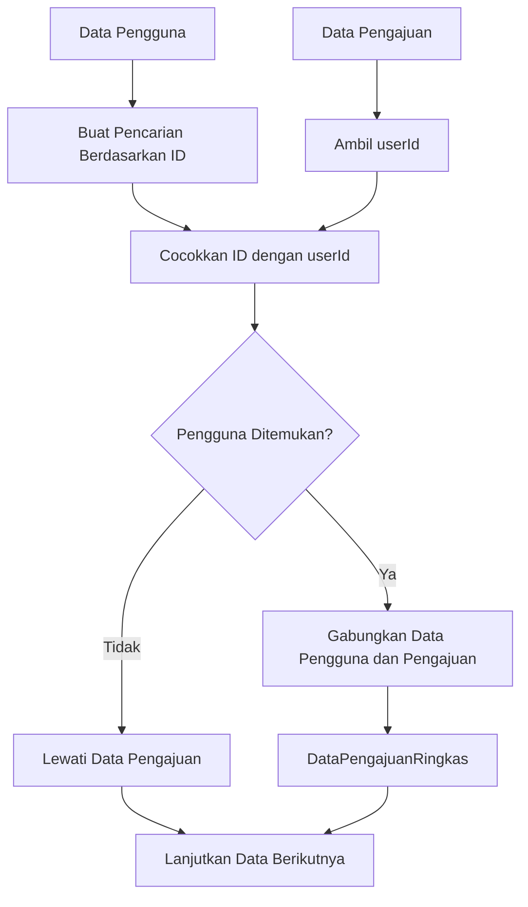

# Diagram Integrasi Data FasKampus

## 1. Gambaran Integrasi

Pada Tugas 10, aplikasi FasKampus menggunakan dua endpoint API dari JSONPlaceholder, yaitu `/users` dan `/posts`.

Kedua endpoint diambil secara bersamaan menggunakan `Future.wait`. Setelah data diterima, service melakukan penggabungan berdasarkan identifier pengguna.

## 2. Diagram Alur Integrasi

## 3. Diagram Proses Penggabungan Data

## 4. Penjelasan Alur

1. Pengguna membuka halaman Integrasi Data dari halaman utama FasKampus.
2. Halaman memanggil method `ambilDataTerintegrasi()` pada `IntegrasiService`.
3. Service menjalankan request GET ke endpoint `/users` dan `/posts`.
4. Response JSON diubah menjadi objek Dart menggunakan `fromJson`.
5. `Future.wait` digunakan untuk menunggu kedua request selesai.
6. Service mencocokkan `userId` dari data pengajuan dengan `id` dari data pengguna.
7. Data yang cocok digabungkan menjadi `DataPengajuanRingkas`.
8. Hasil integrasi dikembalikan ke halaman Flutter.
9. Halaman menampilkan loading, daftar data, empty state, atau error sesuai kondisi hasil request.

## 5. Identifier yang Digunakan

Identifier yang digunakan dalam proses integrasi adalah:

- `id` pada model `DataPengguna`.
- `userId` pada model `DataPengajuan`.

Kedua field tersebut digunakan untuk mengetahui pengguna yang berkaitan dengan suatu pengajuan.

## 6. Alasan Menggunakan Future.wait

Kedua endpoint dapat dipanggil secara bersamaan karena request data pengguna dan data pengajuan tidak harus menunggu satu sama lain.

Dengan `Future.wait`, aplikasi dapat menunggu kedua request selesai sebelum melakukan penggabungan data. Jika salah satu request mengalami kegagalan, proses integrasi akan masuk ke penanganan error.

## 7. Kesimpulan

Diagram ini menggambarkan proses integrasi data FasKampus mulai dari pengambilan response API, parsing JSON, penggabungan berdasarkan identifier, sampai hasilnya ditampilkan pada halaman Flutter.